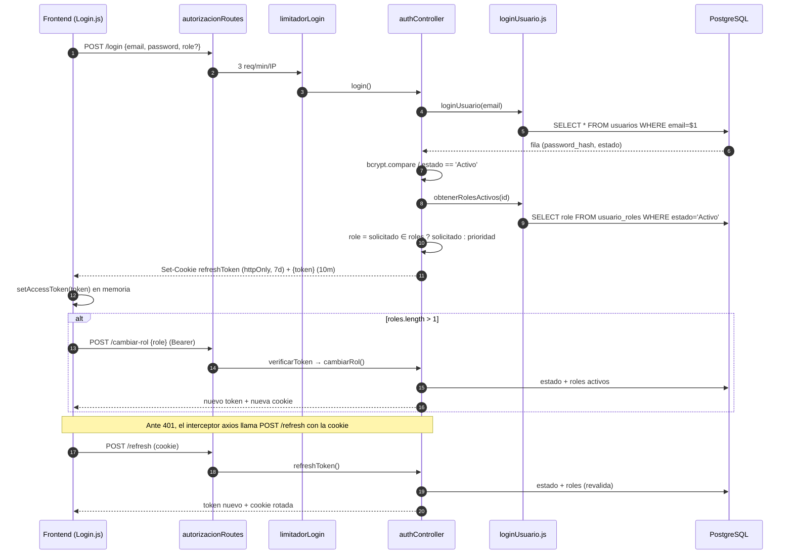
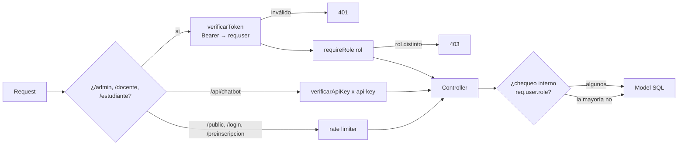
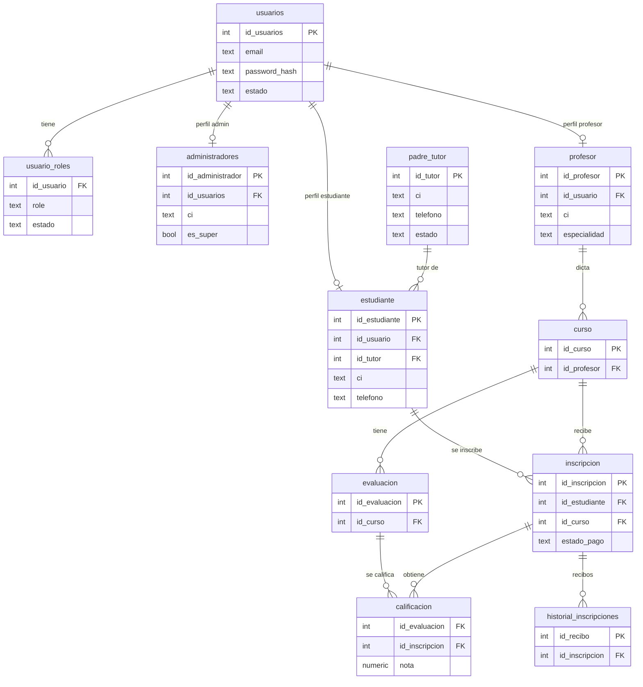

# 01 · Análisis de autenticación y autorización

- **Fecha:** 2026-11-26
- **Rama:** `feature/roles-and-authentication` (desde `main` @ `97e4a70`)
- **Alcance:** solo lectura. No se modificó lógica del sistema.
- **Fuentes:** lectura directa del código, grafo de graphify (`graphify-out/`, 878 nodos) y MCP `codebase-memory-mcp` (1881 nodos).

> **Dato clave antes de empezar:** el sistema **ya tiene multirol parcial**. Existe la tabla `usuario_roles (id_usuario, role, estado)`, el JWT lleva `roles[]` + `role` activo, y hay un endpoint `POST /cambiar-rol` con selector en el login y en el header. Lo que **no** existe es el concepto de *permiso*: todo se decide comparando el string del rol activo.

---

## 1. Flujo de login, refresh, cambio de rol y "registro"

### 1.1 Cadena de archivos

| Paso | Archivo | Qué hace |
|---|---|---|
| Ruta | `backend/routes/autorizacionRoutes.js:8-10` | `POST /login` (con `limitadorLogin`), `POST /refresh`, `POST /cambiar-rol` (con `verificarToken`) |
| Middleware | `backend/middlewares/publicValidaciones/publicLimiter.js:13-21` | 3 intentos por minuto por IP |
| Controller | `backend/controllers/authController.js:61-101` | `login`: busca usuario, `bcrypt.compare`, valida `estado`, lee roles activos, elige rol, firma tokens |
| Model | `backend/models/modelsUsuarios/loginUsuario.js:3-6` | `SELECT * FROM usuarios WHERE email = $1` |
| Model | `backend/models/modelsUsuarios/loginUsuario.js:16-23` | `SELECT role FROM usuario_roles WHERE id_usuario = $1 AND estado = 'Activo'` |
| Controller | `authController.js:103-141` | `refreshToken`: lee cookie, verifica, **vuelve a consultar BD** (estado + roles), rota ambos tokens |
| Controller | `authController.js:144-168` | `cambiarRol`: verifica que el rol pedido esté activo y emite tokens nuevos |
| Middleware | `backend/middlewares/veriificarToken.js:3-19` | Lee `Authorization: Bearer`, `jwt.verify`, deja el payload en `req.user` |
| Middleware | `backend/middlewares/requireRole.js:1-13` | `req.user.role !== role` → 403 (con `console.log` en cada request) |

**Selección del rol activo** (`authController.js:13-16, 89`): si el body trae `role` y el usuario lo tiene activo, se usa; si no, prioridad `administrador > profesor > estudiante`.

### 1.2 "Registro"

No hay auto-registro de cuentas. Hay dos caminos distintos:

1. **Preinscripción pública** (`/register` en el frontend) → `POST /preinscripcion/estudiante` → `pre_inscripcion_estudiante`. **No crea usuario.** Aprobarla (`POST /admin/preinscripcion/aceptada/:id`) solo cambia `estado = 'Aprobada'` (`models/modelsPreInscripcion/preinscripcionAceptada.js:4-8`).
2. **Alta por el administrador**: `POST /admin/estudiantes`, `/admin/profesor`, `/admin/administradores` → `resolverUsuarioParaRol` (`models/modelsUsuarios/crearUsuario.js:39-92`):
   - Si el email/teléfono no existe → `postUsuario` crea `usuarios` (hash bcrypt, cost 10) + `usuario_roles`.
   - Si existe y el CI coincide en alguna tabla de perfil → **reutiliza la cuenta** y agrega el rol (`ON CONFLICT … DO UPDATE SET estado = 'Activo'`). Así nace el multirol.
   - Si el CI pertenece a otra cuenta → error de negocio.
   - **Contraseña inicial = CI** (`estudiantesController.js:59`, `profesorController.js:59`, `administradoresController.js:76`).

### 1.3 Diagrama de secuencia





---

## 2. Modelo de datos actual

No hay scripts SQL, migraciones ni seeds en el repo. Las columnas se **deducen de las consultas** (`backend/models/**`, `backend/controllers/**`).

| Tabla | Columnas relevantes (inferidas) | De dónde sale el rol | Relaciones |
|---|---|---|---|
| `usuarios` | `id_usuarios` PK, `email` (email **o teléfono**), `password_hash`, `estado` ('Activo'/…) | — (cuenta) | 1:N `usuario_roles`; 1:0..1 con cada perfil |
| `usuario_roles` | `id_usuario` FK, `role` (texto libre: `administrador`/`profesor`/`estudiante`), `estado`; UNIQUE(`id_usuario`,`role`) | **Fuente de verdad del rol** | N:1 `usuarios` |
| `administradores` | `id_administrador` PK, `id_usuarios` FK, `nombre`, `a_paterno`, `a_materno`, `ci`, `telefono`, `email`, `fecha_registro`, **`es_super`** | Perfil; `es_super` = "permiso" extra fuera de roles | N:1 `usuarios` (nota: FK se llama `id_usuarios`) |
| `profesor` | `id_profesor` PK, `id_usuario` FK, `nombre`, `a_paterno`, `a_materno`, `ci`, `telefono`, `email`, `especialidad` | Perfil | N:1 `usuarios`; 1:N `curso` |
| `estudiante` | `id_estudiante` PK, `id_usuario` FK, `id_tutor` FK, `nombre`, `a_paterno`, `a_materno`, `ci`, `direccion`, `telefono`, `email`, `colegio` | Perfil | N:1 `usuarios`; N:1 `padre_tutor`; 1:N `inscripcion` |
| `padre_tutor` | `id_tutor` PK, `nombre`, `a_paterno`, `a_materno`, `ci`, `telefono`, `direccion`, `estado` | **No tiene cuenta ni rol.** Solo chatbot por teléfono | 1:N `estudiante` |
| `curso` | `id_curso`, `nombre`, `descripcion`, `duracion` (interval), `costo`, `cupo_total`, `fecha_creacion`, `id_profesor` | — | N:1 `profesor` |
| `inscripcion` | `id_inscripcion`, `id_estudiante`, `id_curso`, `estado_pago` | — | N:1 `estudiante`, N:1 `curso` |
| `evaluacion` | `id_evaluacion`, `id_curso`, `nombre_evaluacion`, `descripcion`, `fecha_evaluacion`, `porcentaje` | — | N:1 `curso` |
| `calificacion` | `id_evaluacion`, `id_inscripcion`, `id_estudiante`, `nota`, `observacion` | — | N:1 `evaluacion`, `inscripcion` |
| `historial_inscripciones` | `id_recibo`, `id_inscripcion`, `padre_tutor`, `padre_ci`, `monto_pagado`, `id_padre`, `id_estudiante`, `estudiante`, `id_curso`, `curso`, `fecha_pago` | — (recibos, datos desnormalizados) | N:1 `inscripcion` |
| `pre_inscripcion_estudiante` | `id_solicitud`, `nombre`, `a_paterno`, `a_materno`, `ci`, `direccion`, `telefono`, `email`, `colegio`, `estado` | — | Ninguna (no se vincula al aprobar) |
| `estudiantes` / `pagos` ⚠️ | `id`, `telefono`, `telefono_tutor` / `estudiante_id`, `concepto`, `monto`… | — | **Solo en `models/modelsChatbot/pagos.js`; no coinciden con el resto del esquema** |

Conclusión: el rol **no** se deduce de la existencia del perfil (`estudiante`/`profesor`/`administradores`), sino de `usuario_roles`. El perfil aporta los datos y el `id_*` que usan las consultas "propias" (ej. `pro.id_usuario = req.user.id`). Dar de baja a un estudiante = `usuario_roles.estado = 'Inactivo'` para ese rol (`estudiantesController.js:254-300`).



---

## 3. JWT, refresh y almacenamiento en el frontend

| Aspecto | Valor | Dónde |
|---|---|---|
| Payload access token | `{ id, email, role, roles, iat, exp }` | `authController.js:18-26` |
| Payload refresh token | `{ id, email, role, type: 'refresh', iat, exp }` | `authController.js:28-36` |
| Firma | HS256 (default) con **el mismo** `JWT_SECRET` para ambos | `authController.js:21, 31` |
| Duración | Access **10 min**; refresh **7 días** | `authController.js:23, 33` |
| Refresh | Sí. Cookie `refreshToken` `httpOnly`, `SameSite=lax` (dev) / `none`+`secure` (prod), `path=/` | `authController.js:38-48` |
| Rotación | Sí, en cada `/refresh` y `/cambiar-rol`. **Sin revocación** (no se guarda en BD; el viejo sigue válido hasta que expire) | `authController.js:133-135` |
| Revalidación | `/refresh` y `/cambiar-rol` reconsultan estado y roles. El access token **no**: un rol quitado sigue sirviendo hasta 10 min | `authController.js:117-126` |
| Logout | Solo borra el token de memoria; **no hay endpoint** que borre la cookie | `frontend/src/components/header/AppHeaderDropdown.js:23-26` |
| Frontend: access token | **En memoria** (variable de módulo), no en localStorage/sessionStorage/Redux | `frontend/src/services/authSession.js:1-12` |
| Frontend: lectura del rol | `jwtDecode(token)` en cada render del guard | `frontend/src/views/utils/usuario.js:4-17` |
| Frontend: Redux | Solo `sidebarShow` y `theme`. No guarda sesión | `frontend/src/store.js:18-21` |
| Frontend: refresh | Interceptor 401 → `POST /refresh` → reintenta. Duplicado en 3 instancias axios (`api.js`, `apiDocente.js`, `apiEstudiante.js`) | `frontend/src/api/api.js:34-78` |

Consecuencia: **al recargar la página se pierde la sesión** (no hay `/refresh` al arrancar; `ProteccionRoute` ve token nulo y manda a `/login`), aunque la cookie de 7 días siga viva.

---

## 4. Todas las rutas del backend

Leyenda: **Token** = `verificarToken`; **Rol** = `requireRole` en `server.js` (+ chequeo interno en controller si se indica). ⚠️ = problema.

### 4.1 Públicas y de autenticación

| Método | Path | Token | Rol | Controller | Nota |
|---|---|---|---|---|---|
| GET | `/` | No | — | inline `server.js:36` | Saludo |
| POST | `/login` | No | — | `authController.login` | Rate limit 3/min |
| POST | `/refresh` | Cookie | — | `authController.refreshToken` | Sin rate limit |
| POST | `/cambiar-rol` | Sí | Cualquiera | `authController.cambiarRol` | Sin rate limit |
| GET | `/perfil` | Sí | Cualquiera | inline `privadaRoutes.js:6` | ⚠️ devuelve `req.usuario` (siempre `undefined`) |
| POST | `/preinscripcion/estudiante` | No | — | `postPreinscripcionEstudiante` | Rate limit 20/10 min. Público a propósito |
| GET | `/public/cursos-disponibles` | No | — | `getCursosDisponibles` | Rate limit 100/15 min |
| GET | `/public/verificar-recibo/:token` | No | — | `getVerificarRecibo` | Token AES-GCM firmado |

### 4.2 `/admin` (Token + `administrador`)

| Método | Path | Controller | Chequeo extra |
|---|---|---|---|
| GET | `/admin/preinscripcion/lista` | `getPreinscripcionEstudiante` | — |
| POST | `/admin/preinscripcion/rechazado/:idSolicitud` | `posPreinscripcionRechazada` | — |
| POST | `/admin/preinscripcion/aceptada/:idSolicitud` | `posPreinscripcionAprobada` | — |
| GET | `/admin/administradores` | `getAdministradores` | super admin |
| POST | `/admin/administradores` | `postAdministrador` | super admin |
| PUT | `/admin/administradores/:id` | `putAdministrador` | super admin |
| DELETE | `/admin/administradores/:id` | `deleteAdministrador` | super admin |
| PUT | `/admin/administradores/:id/activar` | `activarAdministrador` | super admin |
| GET | `/admin/administradores/es-super` | `getEsSuper` | — |
| GET | `/admin/estudiantes` | `getEstudiantes` | `requireRole` repetido |
| POST | `/admin/estudiantes` | `postEstudiante` | — |
| PUT | `/admin/estudiantes/:id` | `putEstudiante` | — |
| DELETE | `/admin/estudiantes/:id` | `deleteEstudiante` | — |
| GET | `/admin/cursos` | `getCursos` | rol interno |
| GET | `/admin/cursos/por-vencer` | `getMostrarCursosPorVencer` | rol interno |
| POST | `/admin/cursos` | `postCursos` | rol interno |
| PUT | `/admin/cursos/:id` | `putCursos` | rol interno |
| DELETE | `/admin/cursos/:id` | `deleteCurso` | rol interno |
| GET | `/admin/profesor` | `getProfesor` | — |
| POST | `/admin/profesor` | `postProfesor` | — |
| PUT | `/admin/profesor/:id` | `putProfesor` | — |
| DELETE | `/admin/profesor/:id` | `deleteProfesor` | — |
| GET | `/admin/inscripciones` | `getInscripciones` | — |
| GET | `/admin/inscripciones/curso/:id` | `getInscripcionesPorCurso` | — |
| GET | `/admin/inscripciones/profesor/:id` | `getInscripcionesPorProfesor` | — |
| POST | `/admin/inscripciones` | `postInscripciones` | — |
| GET | `/admin/inscripciones/estudiante/:id` | `mostrarInscripcionPorEstudiante` | — |
| DELETE | `/admin/inscripciones/:id` | `deleteInscripcionPorId` | — |
| DELETE | `/admin/inscripciones/:id/estudiante` | `deleteinscripcionPorEstudiante` | — |
| DELETE | `/admin/inscripciones/eliminar-por-curso/:idCurso` | `deleteEliminarTodasInscripcionesDelCurso` | rol interno |
| GET | `/admin/inscripciones/control-pagos` | `getControlDePagosEstudiante` | — |
| PUT | `/admin/inscripciones/marcar-pagado/:idInscripcion` | `putMarcarInscripcionComoPagada` | — |
| GET | `/admin/inscripciones/mostrar-recibos` | `getMostrarRecibos` | rol interno |
| POST | `/admin/inscripciones/registrar-recibos` | `postRegistrarRecibos` | rol interno |
| GET | `/admin/padres-tutores` | `getPadresTutors` | rol interno |
| POST | `/admin/padres-tutores/registro` | `postPadreTutor` | rol interno |
| PUT | `/admin/padres-tutores/actualizar/:id` | `putPadreTutor` | rol interno |
| DELETE | `/admin/padres-tutores/eliminar/:id` | `deletePadreTutor` | rol interno |
| PUT | `/admin/habilitar-usuario/:idUsuario?role=` | `putHabilitarUsuario` | rol interno |

### 4.3 `/docente` (Token + `profesor`; las consultas filtran por `req.user.id`)

| Método | Path | Controller |
|---|---|---|
| GET | `/docente/cursos` | `getCursosAsignados` |
| GET | `/docente/estudiantes` | `getEstudiantesAsignados` |
| GET | `/docente/cursos/evaluacion` | `getCursosEvaluacion` |
| GET | `/docente/cursos/evaluacion/examen/:idCurso` | `getEvaluacionCurso` |
| POST | `/docente/cursos/evaluacion/examen/crearEvaluacion` | `postCrearEvaluacionAunCurso` |
| PUT | `/docente/cursos/evaluacion/examen/editarEvaluacion` | `putActualizarEvaluacionDeunCurso` |
| DELETE | `/docente/cursos/evaluacion/examen/eliminarEvaluacion/:idEvaluacion` | `deleteEvaluacionDeunCurso` |
| GET | `/docente/cursos/evaluacion/examen/listarCalificaciones/:idCurso/:idEvaluacion` | `getListarCalificacionesEvaluacion` |
| POST | `/docente/cursos/evaluacion/examen/listarCalificaciones/calificarExamen` | `postCalificarEvaluacion` |
| PUT | `/docente/cursos/evaluacion/examen/listarCalificaciones/editarExamen` | `putCalificarEvaluacion` |
| GET | `/docente/cursos/evaluacion/examen/ya-calificados/:idCurso` | `getMostrarExamenesCalificados` |

### 4.4 `/estudiante` (Token + `estudiante`)

| Método | Path | Controller | Nota |
|---|---|---|---|
| GET | `/estudiante/cursos` | `getMostrarcursosParaEstudiantes` | Propio (`req.user.id`) |
| GET | `/estudiante/curso/calificaciones/:idCurso` | `getMostrarCalificaionesDelEstudiante` | Propio |
| GET | `/estudiante/curso/no-inscritos` | `getMostrarCursosNoInscritosDelEstudiante` | Propio |
| POST | `/estudiante/curso/inscripcion-a-un-curso/:idCurso` | `postCrearInscripcionAunCursoestudiante` | Propio |
| GET | `/estudiante/curso/deudas` | `getMostrarDeudasEstudiante` | Propio |
| GET | `/estudiante/inscripciones` | `getInscripciones` | ⚠️ **CRÍTICO**: todas las inscripciones |
| GET | `/estudiante/inscripciones/curso/:id` | `getInscripcionesPorCurso` | ⚠️ datos de otros |
| GET | `/estudiante/inscripciones/profesor/:id` | `getInscripcionesPorProfesor` | ⚠️ datos de otros |
| POST | `/estudiante/inscripciones` | `postInscripciones` | ⚠️ inscribir a cualquier estudiante |
| GET | `/estudiante/inscripciones/estudiante/:id` | `mostrarInscripcionPorEstudiante` | ⚠️ IDOR |
| DELETE | `/estudiante/inscripciones/:id` | `deleteInscripcionPorId` | ⚠️ borrar inscripciones ajenas |
| DELETE | `/estudiante/inscripciones/:id/estudiante` | `deleteinscripcionPorEstudiante` | ⚠️ |
| GET | `/estudiante/inscripciones/control-pagos` | `getControlDePagosEstudiante` | ⚠️ pagos de todos |
| PUT | `/estudiante/inscripciones/marcar-pagado/:idInscripcion` | `putMarcarInscripcionComoPagada` | ⚠️ **marcarse como pagado** |
| GET/POST | `/estudiante/inscripciones/mostrar-recibos`, `/registrar-recibos` | `getMostrarRecibos`, `postRegistrarRecibos` | Bloqueadas por chequeo interno |
| DELETE | `/estudiante/inscripciones/eliminar-por-curso/:idCurso` | `deleteEliminarTodasInscripcionesDelCurso` | Bloqueada por chequeo interno |

Origen: `backend/server.js:58` monta `inscripcionRoutes` (pensado para admin) bajo `/estudiante`. **El frontend no usa ninguna de estas rutas** (`grep` en `frontend/src/services`), así que quitar ese montaje no rompe nada visible.

### 4.5 `/api/chatbot` (API key `x-api-key`, sin JWT)

| Método | Path | Controller | Control de pertenencia |
|---|---|---|---|
| POST | `/api/chatbot/identificar` | `identificar` | Devuelve estudiantes cuyo teléfono (o el del tutor activo) coincide |
| GET | `/api/chatbot/estudiantes/:id/calificaciones?telefono=` | `obtenerCalificaciones` | Sí, por teléfono |
| GET | `/api/chatbot/estudiantes/:id/inscripcion?telefono=` | `getInscripcion` | Sí, por teléfono |
| GET | `/api/chatbot/estudiantes/:id/pagos?telefono=` | `getPagos` | ⚠️ consulta tablas `estudiantes`/`pagos` que no existen en el resto del esquema |
| GET | `/api/chatbot/cursos` | `getCursosActivos` | Público para el bot |

**Rutas privadas sin protección real:** las 9 marcadas ⚠️ en 4.4. En `/admin` todo pasa por `verificarToken + requireRole('administrador')`, por lo que no hay rutas abiertas; los chequeos internos son redundantes.

---

## 5. Protección en el frontend

| Pieza | Archivo | Comportamiento |
|---|---|---|
| Router raíz | `frontend/src/App.js:117-136` | `HashRouter`. Públicas: `/`, `/login`, `/register`, `/verificar-recibo/:token`. Todo lo demás (`*`) va dentro de `ProteccionRoute` → `DefaultLayout` |
| Guard de sesión | `components/ProteccionRoute.js:4-10` | Solo mira si hay token en memoria y se decodifica |
| Guard de rol | `components/proteccionRol.js:4-15` | `rolesPermitidos.includes(usuario.role)`; si no, redirige a la ruta principal |
| Tabla de rutas | `src/routes.js:78-161` | Cada ruta tiene `roles: [...]`; `AppContent.js:48-69` envuelve con `ProteccionRol` |
| Menú | `src/_nav.js` + `components/AppSidebarNav.js:16` | Filtra por `item.roles.includes(rol)`. `soloSuper` se resuelve con `GET /admin/administradores/es-super` (`AppSidebar.js:54-73`) |
| Cambio de rol | `AppHeaderDropdown.js:28-45`, `Login.js:48-81` | Muestra los otros `roles` del JWT; llama `/cambiar-rol` y fuerza re-render con `notificarCambioRol` (`DefaultLayout.js:8-11`) |
| Redux | `store.js` | No participa en auth |
| Pantalla "Gestión de accesos" | `views/gestionAdministrador/gestionAccesos/rolesAcceso.js` | Catálogo **estático** de roles (incluye `super-administrador`, `docente`, `padre-familia`) con textos de "puede / no puede". No viene del backend |

Observaciones: la protección del frontend es solo UX (el backend es quien decide). Los ids de `rolesAcceso.js` (`docente`, `padre-familia`) no coinciden con los del backend (`profesor`, no existe rol de padre).

---

## 6. Chatbot n8n

- **Estado del repo:** `chatbot/workflows/01-identificar-usuario.json` … `99-manejo-errores.json` están **vacíos (0 bytes)**. Solo `00-principal.json` tiene contenido (11 nodos) y arranca con un **Manual Trigger + nodo "datos de prueba"** con `telefono: "55555555"`; todavía no hay trigger de WhatsApp (evolution-go) en el repo.
- **Identificación:** n8n llama `POST /api/chatbot/identificar {telefono}` con la API key (credencial `httpHeaderAuth`). El backend (`models/modelsChatbot/identificar.js:3-13`) devuelve los estudiantes donde `padre_tutor.telefono = $1 AND padre_tutor.estado = 'Activo'` **o** `estudiante.telefono = $1`.
- **Roles:** el chatbot **no usa `usuarios` ni `usuario_roles`**. La identidad es "quien tiene ese teléfono". Un estudiante dado de baja (rol `estudiante` inactivo) sigue siendo identificado y puede consultar notas e inscripciones por su teléfono.
- **Filtrado de datos de otros:** las rutas por estudiante validan que el `:id` pertenezca al `telefono` recibido (`chatbot.controller.js:17-22`, `calificacionesChatbotController.js:13-19`). La seguridad depende de que **n8n pase el teléfono real del remitente de WhatsApp** y no uno escrito por el usuario. Quien tenga la API key puede consultar cualquier teléfono.
- **LLM:** el AI Agent (Gemini) solo tiene la herramienta `consultar_cursos` (datos públicos) y memoria por `telefono`. No recibe datos personales.

---

## 7. Problemas detectados

### 7.1 Seguridad

| # | Severidad | Archivo:línea | Problema |
|---|---|---|---|
| S1 | **Crítica** | `backend/server.js:58` | `inscripcionRoutes` montado bajo `/estudiante`: un estudiante puede listar, crear y borrar inscripciones ajenas y **marcar inscripciones como pagadas**. Los handlers no validan rol internamente (`inscripcionController.js:11-150`, `controlDePagosEstudiante.js:100-130`) |
| S2 | Alta | `backend/.env.example:5` | `JWT_SECRET` con valor real en el repo. Si alguien copia el example, los tokens se pueden falsificar (no hay `backend/.env` local para comparar) |
| S3 | Alta | `estudiantesController.js:59`, `profesorController.js:59`, `administradoresController.js:76` | Contraseña inicial = CI (predecible) y no hay flujo de cambio obligatorio |
| S4 | Media | `middlewares/veriificarToken.js:10-15` | Acepta un **refresh token como access token** (no valida `type`); mismo secreto para ambos (`authController.js:21, 31`). No verifica el esquema `Bearer` |
| S5 | Media | `authController.js:38-48`, `AppHeaderDropdown.js:23-26` | Sin logout en backend ni revocación de refresh: la cookie de 7 días sobrevive al "Cerrar sesión" |
| S6 | Media | `authController.js:67` vs `:74` | Mensajes distintos para "usuario no existe" y "contraseña incorrecta" → enumeración de usuarios. Además responde 400 en vez de 401 |
| S7 | Media | `authController.js:63-71` | Sin validación de body en `/login` (`password` ausente → excepción → 500) |
| S8 | Media | `publicLimiter.js:13-21`, `server.js` | Sin `app.set('trust proxy')`: detrás de un proxy todos comparten IP (3 logins/min para toda la academia). `/refresh` y `/cambiar-rol` sin límite |
| S9 | Baja | `middlewares/requireRole.js:3-7` | `console.log` de URL y roles en **cada** request protegido |
| S10 | Baja | `gestionProfesor/calificarEvaluacion.js:5`, `models/modelsCursos/crearCursos.js:11`, `estudiantesController.js:93` | Logs de `req.user` y datos |
| S11 | Baja | `loginUsuario.js:4` vs `crearUsuario.js:44` | Login compara email exacto; el alta compara con `LOWER()`. Usuarios con mayúsculas no pueden entrar |
| S12 | Baja | `validacionChatbot/apiKey.middleware.js:3` | Comparación de API key no constante en tiempo; una sola key para todas las rutas del bot |
| S13 | Baja | `models/modelsChatbot/identificar.js:8-9` | No filtra estudiantes inactivos |
| S14 | Baja | `server.js` | Sin `helmet` ni manejador global de errores |

### 7.2 Código muerto

| Archivo | Situación |
|---|---|
| `backend/models/User.js` | Array en memoria `users = []`; nadie lo importa |
| `backend/archivoTemporal.js` | Script que imprime el hash de `'luis'` (parece una contraseña de desarrollo) |
| `backend/testUnsplash.js` | Script manual de prueba de la API de Unsplash |
| `backend/package.json:41-42` | `sequelize` y `pg-hstore` instalados y sin uso |
| `backend/routes/privadaRoutes.js` | `/perfil` no lo usa el frontend y está roto (`req.usuario`) |
| `chatbot/workflows/01…99` | Archivos vacíos |
| `backend/package.json:8` | `"test": "node server.js"` no es un test |

### 7.3 Inconsistencias

| Archivo:línea | Inconsistencia |
|---|---|
| `backend/middlewares/veriificarToken.js` | Nombre con doble "i" (importado así en 4 archivos) |
| `veriificarToken.js:14` vs `privadaRoutes.js:9` | `req.user` vs `req.usuario` |
| `administradoresController.js:35, 279` | `req.user.id_usuarios ?? req.user.id` (el payload solo trae `id`) |
| `administradores.id_usuarios` vs `profesor.id_usuario` / `estudiante.id_usuario` | Nombre de FK distinto |
| `server.js:47-54` | 7 montajes `/admin` repiten `verificarToken + requireRole` (cada request verifica el JWT varias veces) |
| `cursosController.js`, `padreTutorController.js`, `controlDePagosEstudiante.js`, `authController.js:172` | Chequeos `req.user.role !== 'administrador'` duplicados dentro de los controllers: hay que tocarlos todos al migrar a permisos |
| `authController.js:13`, `authController.js:177`, `Login.js:30`, `AppHeaderDropdown.js:30`, `usuario.js:20` | Lista de roles hardcodeada en 5 lugares |
| `frontend/src/api/api.js`, `apiDocente.js`, `apiEstudiante.js` | Interceptor de refresh copiado 3 veces con flags `refreshEnProceso` separados (pueden correr 3 refresh en paralelo y rotar la cookie en carrera) |
| `frontend/src/api/api.js:71-74` | Cualquier **403** cierra la sesión (incluso un 403 de negocio) |
| `models/modelsChatbot/pagos.js:5` | Tablas `estudiantes`/`pagos` con columnas que no existen en el resto del esquema |
| `rolesAcceso.js` | Ids `docente`/`padre-familia` vs `profesor` del backend |
| `README.md` | Dice MongoDB; el proyecto usa PostgreSQL |
| `backend/Dockerfile`, `frontend/Dockerfile` | Symlinks para corregir mayúsculas de imports (`inscripcioncontroller.js`, `tablaProfesores.js`) |

---

## 8. Propuestas de diseño para multirol y multipermiso

### Base común (vale para las 3 opciones)

Tablas nuevas (SQL **propuesto**, lo ejecuta el usuario):

```sql
CREATE TABLE roles (
  id_rol      SERIAL PRIMARY KEY,
  codigo      TEXT UNIQUE NOT NULL,
  nombre      TEXT NOT NULL,
  descripcion TEXT,
  es_sistema  BOOLEAN NOT NULL DEFAULT false
);

CREATE TABLE permisos (
  id_permiso  SERIAL PRIMARY KEY,
  codigo      TEXT UNIQUE NOT NULL,
  modulo      TEXT NOT NULL,
  descripcion TEXT
);

CREATE TABLE rol_permisos (
  id_rol     INT REFERENCES roles(id_rol) ON DELETE CASCADE,
  id_permiso INT REFERENCES permisos(id_permiso) ON DELETE CASCADE,
  PRIMARY KEY (id_rol, id_permiso)
);
```

`usuario_roles` **se conserva** (ya es la tabla usuario↔rol). Solo se le agrega la FK al catálogo:

```sql
INSERT INTO roles (codigo, nombre, es_sistema) VALUES
  ('super_administrador', 'Super administrador', true),
  ('administrador', 'Administrador', true),
  ('profesor', 'Profesor', true),
  ('estudiante', 'Estudiante', true);

-- Verificar antes que no haya valores fuera del catálogo:
-- SELECT DISTINCT role FROM usuario_roles;

ALTER TABLE usuario_roles
  ADD CONSTRAINT fk_usuario_roles_rol FOREIGN KEY (role) REFERENCES roles(codigo);
```

Permisos con formato `modulo:accion[:alcance]`, por ejemplo: `estudiantes:leer`, `estudiantes:crear`, `inscripciones:leer`, `inscripciones:marcar_pago`, `recibos:registrar`, `administradores:gestionar`, `evaluaciones:gestionar:propias`, `calificaciones:leer:propias`. El seed de `rol_permisos` replica **exactamente** el acceso de hoy (admin = todo lo de `/admin` menos `administradores:gestionar`; super = todo; profesor = lo de `/docente`; estudiante = lo de `/estudiante` sin las rutas de `inscripcionRoutes`).

Middleware nuevo, convive con `requireRole`:

```js
export const requirePermission = (...requeridos) => (req, res, next) => {
  const permisos = req.user?.permisos ?? []
  if (!requeridos.every((p) => permisos.includes(p))) {
    return res.status(403).json({ message: 'Acceso denegado' })
  }
  next()
}
```

Paso previo independiente de la opción elegida: **cerrar S1** (quitar `server.js:58`), porque hoy es explotable y no depende del diseño.

---

### Opción A — Permisos del rol activo dentro del JWT

Se mantiene el modelo actual de "rol activo" (`role`) y al firmar el access token se agregan los permisos de ese rol: `{ id, email, role, roles, permisos: [...] }`.

- **Ventajas:** cambio mínimo; cero consultas por request; el frontend lee los permisos con el `jwtDecode` que ya usa; encaja con `/cambiar-rol` y con el selector de rol existente.
- **Desventajas:** un permiso quitado tarda hasta 10 min en aplicarse (TTL del access token); JWT más grande (~30-60 permisos, aceptable); sin permisos por usuario.
- **Archivos afectados:** `authController.js` (firmar con permisos), `loginUsuario.js` (consulta `obtenerPermisosDeRol`), `middlewares/requirePermission.js` (nuevo), `server.js` y routers (cambiar `requireRole` por `requirePermission` por ruta), controllers con chequeo interno de rol, `administradoresController.js` (`es_super` → rol `super_administrador`). Frontend: `routes.js`, `_nav.js`, `proteccionRol.js`, `AppSidebarNav.js`, `AppSidebar.js` (quitar llamada a `es-super`), `usuario.js`. Chatbot: sin cambios.
- **Migración:** crear tablas + seed equivalente; asignar `super_administrador` en `usuario_roles` a quienes tienen `es_super = true` (la columna se mantiene hasta terminar). `requirePermission` con *fallback*: si el token no trae `permisos` (tokens viejos), se calculan del `role`. Como el access dura 10 min, en 10 min todos tienen tokens nuevos. Cambiar ruta por ruta; los usuarios no notan nada.

### Opción B — Unión de todos los roles + permisos por usuario, consultados en BD con caché

Se elimina el concepto de "rol activo": el usuario tiene la **unión** de los permisos de todos sus roles activos más ajustes individuales.

```sql
CREATE TABLE usuario_permisos (
  id_usuario INT REFERENCES usuarios(id_usuarios) ON DELETE CASCADE,
  id_permiso INT REFERENCES permisos(id_permiso) ON DELETE CASCADE,
  efecto     TEXT NOT NULL CHECK (efecto IN ('permitir', 'denegar')),
  PRIMARY KEY (id_usuario, id_permiso)
);
```

El JWT solo lleva `{ id, email }`. `requirePermission` resuelve permisos con una caché en memoria (Map con TTL de ~60 s, invalidada al editar roles/permisos de ese usuario).

- **Ventajas:** revocación casi inmediata; permisos por usuario (`denegar` gana); un profesor que también es administrador no necesita cambiar de rol.
- **Desventajas:** cambio grande de UX y de consultas: hoy las consultas "propias" usan `req.user.id` según el rol activo (estudiante vs profesor), y con la unión hay que decidir el contexto por ruta (`/docente/*` usa perfil profesor, `/estudiante/*` perfil estudiante); caché en memoria no sirve si hay más de una instancia del backend; una consulta más por request en caché fría; hay que retirar el selector de rol del login y del header.
- **Archivos afectados:** todo lo de A, más `veriificarToken.js` (cargar permisos), nuevo `services/permisosCache.js`, `crearUsuario.js`/`loginUsuario.js` (invalidación), `Login.js` y `AppHeaderDropdown.js` (quitar selector), `DefaultLayout.js`, `authSession.js`; endpoint nuevo `GET /mis-permisos` para el frontend. Pantalla de gestión de accesos pasa a ser real (CRUD de roles/permisos). Chatbot: sin cambios.
- **Migración:** las mismas tablas + `usuario_permisos` vacía. Se puede activar por rutas; mientras tanto el JWT sigue trayendo `role` para el frontend viejo. Retirar `/cambiar-rol` al final, cuando el frontend ya consuma `/mis-permisos`.

### Opción C — Híbrida (recomendada): rol activo + permisos en el JWT + versión de permisos + overrides por usuario

Mantiene el rol activo (el usuario elige "entrar como profesor/estudiante/admin", que ya funciona y define el contexto de las consultas propias). El JWT lleva `permisos` del rol activo **ya combinados** con `usuario_permisos`, y un claim `pv` (versión de permisos). `usuarios.permisos_version` se incrementa cuando se cambian roles o permisos del usuario; `verificarToken` compara `pv` contra una caché (TTL corto) y, si cambió, responde 401 → el frontend hace `/refresh` automáticamente (el interceptor ya existe) y obtiene permisos nuevos.

```sql
ALTER TABLE usuarios ADD COLUMN permisos_version INT NOT NULL DEFAULT 1;
-- + tabla usuario_permisos de la opción B
```

- **Ventajas:** conserva la UX actual y el selector de rol; revocación rápida sin consultar permisos en cada request (solo un entero cacheado); permisos por usuario opcionales; el frontend sigue decodificando el JWT. Se puede implementar en dos pasos: paso 1 = Opción A; paso 2 = `pv` + `usuario_permisos`.
- **Desventajas:** más piezas que A (versión + caché); la caché de `pv` tiene el mismo límite de una instancia que B (aceptable con docker-compose de un solo backend; si se escala, mover a Redis o consultar `pv` sin caché, que es una lectura por PK).
- **Archivos afectados:** los de A, más `veriificarToken.js` (chequeo de `pv` y de `type !== 'refresh'`, que cierra S4), nuevo `services/versionPermisos.js`, modelos de alta/edición de roles (`crearUsuario.js`, `loginUsuario.js:25-43`, `crudAdministradores.js:68-79`, `estudiantesController.js:254-300`, `profesorController.js`) para incrementar `permisos_version`. Frontend: lo de A y unificar los 3 interceptores (`api.js`, `apiDocente.js`, `apiEstudiante.js`) para que el refresh por `pv` no corra en paralelo.
- **Migración:** igual que A en el paso 1. En el paso 2 la columna nace con `DEFAULT 1` y los tokens sin `pv` se tratan como `pv = 1`, así que ningún usuario pierde la sesión.

### Comparación rápida

| Criterio | A | B | C |
|---|---|---|---|
| Esfuerzo | Bajo | Alto | Medio (en 2 pasos) |
| Revocación | ≤ 10 min | ~60 s (TTL caché) | Inmediata en el siguiente request |
| Permisos por usuario | No | Sí | Sí (paso 2) |
| Cambia UX de selección de rol | No | Sí (la quita) | No |
| Consultas extra por request | 0 | 1 en caché fría | 1 entero en caché fría |
| Riesgo de migración | Bajo | Medio | Bajo |

### Impacto transversal

- **Frontend:** `routes.js` y `_nav.js` pasan de `roles: [...]` a `permiso: '...'` (mantener `roles` como fallback mientras dure la migración); `ProteccionRol` → `ProteccionPermiso`; `rolesAcceso.js` debería leerse de `GET /roles` en lugar de ser estático. Conviene restaurar sesión al recargar (`/refresh` al arrancar), porque con más roles y permisos el reload que expulsa al usuario se vuelve más molesto.
- **Chatbot:** no usa JWT ni roles; ninguna opción lo rompe. Recomendaciones aparte: filtrar estudiantes inactivos en `identificar.js`, arreglar `pagos.js` y, si a futuro los padres entran a la web, crear el rol `padre_tutor` y una FK `padre_tutor.id_usuario`.
- **Super administrador:** pasa de columna `es_super` a rol `super_administrador` con permiso `administradores:gestionar`; `getEsSuper` y la llamada del sidebar desaparecen cuando el menú lea permisos.

---

## 9. Configuración del entorno realizada en esta sesión

| Ítem | Estado |
|---|---|
| Rama `feature/roles-and-authentication` | Creada desde `main` limpio. Sin commits |
| graphify 0.9.66 (`uv tool`, paquete `graphifyy`) | Ya instalado global; skill ya registrada en `~/.claude/skills/graphify`. Grafo generado con `extract . --code-only` (AST local, sin API) + `cluster-only --no-label` → `graphify-out/` (878 nodos, 2218 aristas, 39 comunidades). Exclusiones en `.graphifyignore` |
| codebase-memory-mcp 0.11.0 | Ya instalado global (hooks en `~/.claude/settings.json`). `.mcp.json` copiado de CheckMate; agentes `codebase-memory*` y skill copiados a `.claude/` (versiones del 22/11 de CheckMate). Repo indexado: proyecto `D-tesis-peresoso-brilliand-minds`, 1881 nodos, 3994 aristas. `tools/list` responde con 17 herramientas |
| `CLAUDE.md` | Creado en la raíz |
| `.gitignore` | Agregados `docs/avances/`, `graphify-out/`, `.VSCodeCounter/` |
