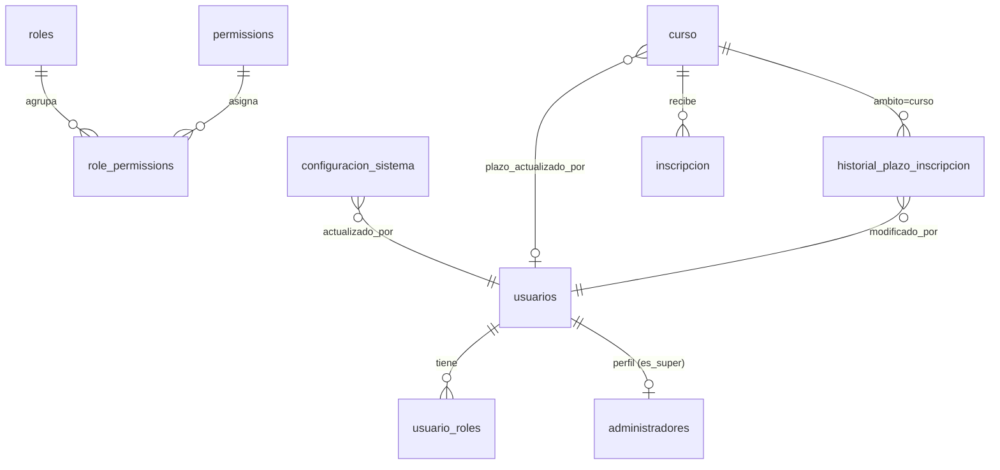
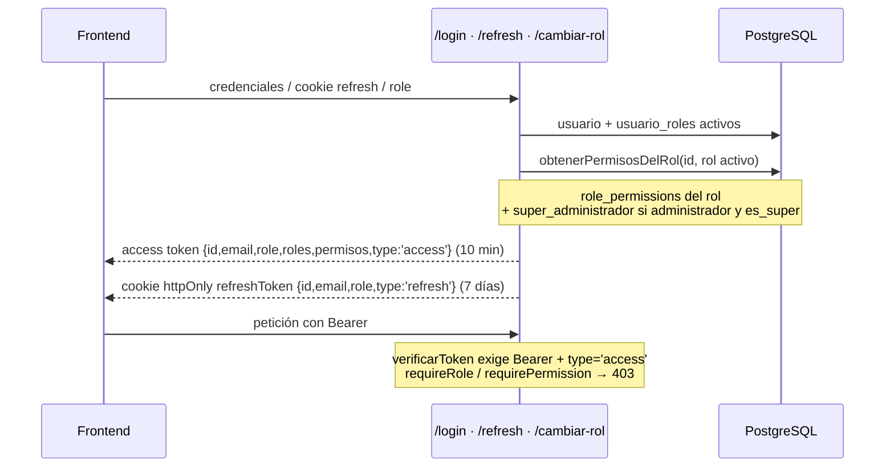
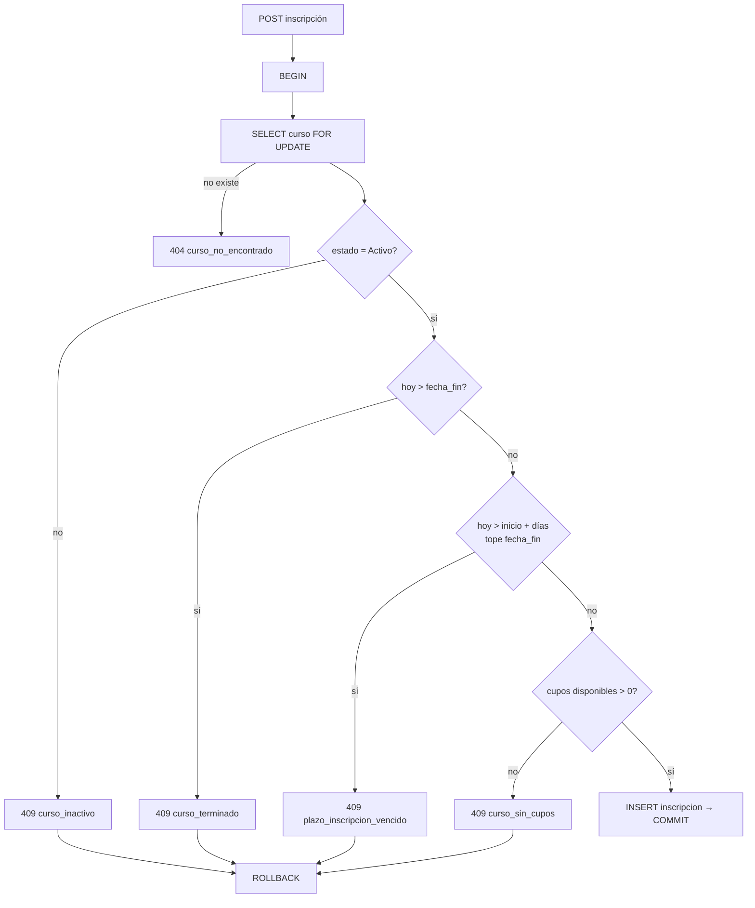

# 03 · Permisos por rol y plazo de inscripción dinámico

Rama: `feature/roles-and-authentication` · Fecha: 2026-11-26 · Sin commits (los hace el usuario).

## 1. Resumen

- **Arreglo de seguridad.**
  - Se quitó el montaje `app.use('/estudiante', …, inscripcionRoutes)`. Exponía al rol estudiante las rutas de inscripciones del administrador: listar, eliminar, marcar pagado y control de pagos.
  - El access token ahora lleva `type: 'access'` y el refresh token `type: 'refresh'`. `verificarToken` exige `Bearer` y `type === 'access'`, así que un refresh token ya no sirve como access token.
- **Base de permisos (paso A de la opción C).**
  - Tablas nuevas: `roles`, `permissions` y `role_permissions`, con 50 permisos en inglés con puntos.
  - El JWT lleva `permisos` (array) del rol activo. Se recalculan en login, refresh y cambiar-rol.
  - El super administrador se deriva de `administradores.es_super`.
  - Middleware `requirePermission(...)` (convive con `requireRole`). En el frontend, `hasPermission()`; las rutas y el menú aceptan `permiso`.
- **Plazo de inscripción dinámico.**
  - Ya no hay "10 días" fijos: valor global en `configuracion_sistema` (solo lo edita el super admin) y un valor opcional por curso (el admin, con `courses.enrollment_deadline.update`), de 0 a 90 días.
  - La fecha límite se calcula en vivo (`inicio + días`, como máximo la fecha de fin) y nunca se guarda. Cada cambio queda en un historial (quién y cuándo).
- **Una sola validación de inscripción.**
  - Mismo orden para estudiante y administrador: estado del curso → curso terminado → plazo (zona America/La_Paz) → cupos (`SELECT … FOR UPDATE`). Cada caso devuelve un 409 con su mensaje.
  - La inscripción del administrador ahora es una transacción real.
  - El chatbot solo informa si la inscripción está abierta y hasta cuándo.
- **Frontend.**
  - Se borraron las 4 copias de la regla de 10 días; todas las pantallas usan el estado que manda el backend.
  - Gestión de cursos muestra la columna "Inscripción" y el botón "Plazo", que abre un modal con vista previa en vivo.
  - Página nueva **Configuración** (`/admin/configuracion`).
  - En el formulario de curso, la etiqueta pasó de "Fecha de creación" a "Fecha de inicio".
- **Pruebas.**
  - Base local `brilliand_minds_test`: 88/88 casos contra la API real.
  - La vista previa del frontend coincide con el backend en los 13 cursos (13/13).
  - Lint del backend (`standard`) y del frontend (eslint) sin errores; build de Vite OK.

## 2. Archivos

| Ruta | Estado | Qué | Por qué |
|---|---|---|---|
| `backend/server.js` | modificado | Quita `/estudiante` + `inscripcionRoutes`; monta `plazoInscripcionRoutes` en `/admin` | Fuga de rutas de admin al estudiante; endpoints de plazo |
| `backend/middlewares/veriificarToken.js` | modificado | Exige `Bearer` y `type === 'access'`; exporta `TIPO_ACCESS_TOKEN`/`TIPO_REFRESH_TOKEN` | El refresh token no debe servir como access |
| `backend/middlewares/requireRole.js` | modificado | Compara `req.user?.role`, responde 403 sin logs | Simplificar y evitar errores si falta el usuario |
| `backend/middlewares/requirePermission.js` | creado | `requirePermission(...permisos)` contra `req.user.permisos` | Autorización por permiso |
| `backend/models/modelsUsuarios/permisosUsuario.js` | creado | `obtenerPermisosDelRol(idUsuario, role)` | Permisos efectivos del rol activo (+ super) |
| `backend/controllers/authController.js` | modificado | `emitirSesion()` común a login, refresh y cambiar-rol; claim `type`; permisos en el JWT | Permisos y separación de tokens |
| `backend/routes/privadaRoutes.js` | modificado | `/perfil` devuelve `{id,email,role,roles,permisos}` | Antes devolvía datos inconsistentes |
| `backend/models/modelsCursos/estadoInscripcionCurso.js` | creado | Fragmento SQL `unirEstadoInscripcion()`, columnas de estado, `bloquearCurso()` | Una sola fuente de verdad del estado |
| `backend/services/validarInscripcion.js` | creado | `validarInscripcionACurso()`, `ErrorInscripcion`, `responderErrorInscripcion()` | Validación única con mensajes claros |
| `backend/models/modelsCursos/plazoInscripcion.js` | creado | Lectura, escritura y bloqueo del plazo global y por curso; historial; conteo por estado | Plazo dinámico |
| `backend/controllers/plazoInscripcionController.js` | creado | GET/PUT del plazo global y por curso | Plazo dinámico |
| `backend/middlewares/plazoInscripcionValidacion/plazoInscripcionValidator.js` | creado | express-validator: `dias` entero 0–90 (o `null` en curso) | Validación de entrada |
| `backend/routes/gestionAdministrador/plazoInscripcionRoutes.js` | creado | 4 rutas con `requirePermission` | Plazo dinámico |
| `backend/controllers/inscripcionController.js` | modificado | `postInscripciones` en una transacción real con `pool.connect()`; valida cada curso nuevo | P8 (transacción falsa) y P9 (cupos) |
| `backend/controllers/gestionEstudiante/cursosParaEstudiantes.js` | modificado | Inscripción del estudiante en una transacción con validación | Plazo, cupos y estado |
| `backend/models/modelsGestionEstudiante/cursosEstudiante/obtenerCursosEstudiante.js` | modificado | Estado en "no inscritos"; `crearInscripcionAunCurso` acepta un cliente | Transacción y estado en el frontend |
| `backend/routes/gestionEstudiante/gestionEstudianteRoutes.js` | modificado | `requirePermission('learning.enrollments.create')` + validación de `idCurso` | Permisos |
| `backend/routes/inscripcionRoutes.js` | modificado | `requirePermission('enrollments.create')` en POST | Permisos |
| `backend/models/modelsCursos/mostrarCurso.js` | modificado | Columnas de estado de inscripción en el listado de admin | Columna "Inscripción" |
| `backend/models/modelsPublicas/cursosDisponibles.js` | modificado | Columnas de estado en el portal público | Quitar la copia F1 |
| `backend/models/modelsChatbot/cursos.js` | modificado | `inscripcion_abierta`, `fecha_limite_inscripcion` | El chatbot informa |
| `backend/peticion-permisos.http` | creado | Peticiones de ejemplo (contraseña vía `$dotenv TEST_PASSWORD`) | Pruebas manuales |
| `frontend/src/views/utils/usuario.js` | modificado | `obtenerPermisos()`, `hasPermission()` | Permisos en la UI |
| `frontend/src/views/utils/plazoInscripcion.js` | creado | Límites 0–90, textos de estado, fecha de hoy en La Paz, vista previa, estado visual | Lógica compartida |
| `frontend/src/services/plazoInscripcionService.js` | creado | GET/PUT del plazo global y por curso | API |
| `frontend/src/views/cursos/components/PlazoInscripcionModal.js` | creado | Modal con 0–90, "usar global", vista previa en vivo, último cambio e historial | Editar el plazo por curso |
| `frontend/src/views/cursos/components/CursoTable.js` | modificado | Columna "Inscripción" y botón "Plazo" (solo con permiso) | Gestión de cursos |
| `frontend/src/views/cursos/components/CursoFormulario.js` | modificado | Etiqueta "Fecha de inicio" | P10 |
| `frontend/src/views/configuracion/ConfiguracionAcademia.js` | creado | Plazo global (solo lectura sin permiso de edición), cursos por estado, historial | Valor global |
| `frontend/src/routes.js`, `frontend/src/_nav.js` | modificado | Ruta y menú "Configuración" con `permiso: 'settings.enrollment_deadline.read'` | Página nueva |
| `frontend/src/components/proteccionRol.js`, `AppContent.js`, `AppSidebarNav.js` | modificado | Soporte de `permiso` en rutas y menú | Permisos en la UI |
| `frontend/src/views/pages/home/components/CursosDisponibles.js` | modificado | Usa el estado del backend (F1) | Quitar los 10 días fijos |
| `frontend/src/views/gestionEstudiante/.../TablePreinscripcionACursosEstudiantes.js` | modificado | Usa el estado del backend (F2) | Quitar los 10 días fijos |
| `frontend/src/views/estudiantes/components/EstudianteTable.js` | modificado | Lista los cursos abiertos más los ya seleccionados (F3) | Quitar los 10 días fijos sin ocultar inscripciones existentes |
| `frontend/src/views/inscripciones/Inscripciones.js` | modificado | Borra código muerto (F4) | Quitar los 10 días fijos |
| `.gitignore` | modificado | `docs/avances/`, `graphify-out/`, `.VSCodeCounter/`, `backend/.env.test` | No subir bitácoras ni secretos |
| `backend/.env.test` | creado (ignorado) | Puerto 5001, base de pruebas, secretos nuevos | Pruebas locales |
| `docs/avances/sql/00-esquema-base.sql` | creado | Esquema deducido del código + tabla de supuestos | **Solo pruebas** |
| `docs/avances/sql/02-plazo-inscripcion.sql`, `03-permisos.sql` | creado | Migraciones con verificación y rollback | Base de datos |
| `docs/avances/sql/90-datos-prueba.sql` | creado | Datos `TEST_` idempotentes; con `-v solo_borrar=1` solo borra | Pruebas |
| `docs/avances/pruebas/pruebas-humo.mjs`, `usuarios-prueba.json` | creado | Script de humo (node + fetch) y credenciales de prueba | Pruebas |

## 3. Base de datos

**Nuevo:**
- `configuracion_sistema`: una sola fila (`id = 1`), con `dias_plazo_inscripcion` 0–90 (por defecto 10), `actualizado_por` y `actualizado_en`.
- En `curso`:
  - `dias_plazo_inscripcion`: NULL significa que usa el global.
  - `plazo_actualizado_por`.
  - `plazo_actualizado_en`.
- `historial_plazo_inscripcion`:
  - `ambito`: global o curso.
  - `id_curso`.
  - `dias_anterior`.
  - `dias_nuevo`.
  - `modificado_por`.
  - `modificado_en`.
- Tablas de permisos:
  - `roles`: `code` PK.
  - `permissions`: `code` PK con CHECK de formato y `module`.
  - `role_permissions`: PK `(role_code, permission_code)`.



`usuario_roles.role` no tiene FK a `roles` (no se renombran tablas existentes). El SQL 03 verifica que no haya roles fuera del catálogo.

**Orden:**
1. `02-plazo-inscripcion.sql`.
2. `03-permisos.sql` (aborta si falta el 02 o `curso.estado`).

**Rollback:** comentado al final de cada archivo. Se deshace en orden inverso: primero 03 (`role_permissions`, `permissions`, `roles`), después 02 (`historial_plazo_inscripcion`, columnas de `curso`, `configuracion_sistema`).

## 4. Roles × permisos

| Rol | Cant. | Permisos |
|---|---|---|
| administrador | 30 | `students.*`, `teachers.*`, `guardians.*`, `courses.*` (+ `courses.enrollment_deadline.update`), `enrollments.*`, `payments.read`, `payments.mark_paid`, `receipts.*`, `preregistrations.*`, `users.enable`, `admins.super_status.read`, `settings.enrollment_deadline.read` |
| super_administrador (derivado de `es_super`) | +6 = 36 | `admins.read/create/update/delete/activate`, `settings.enrollment_deadline.update` |
| profesor | 9 | `teaching.courses.read`, `teaching.students.read`, `teaching.evaluations.*`, `teaching.grades.*` |
| estudiante | 5 | `learning.courses.read`, `learning.grades.read`, `learning.available_courses.read`, `learning.enrollments.create`, `learning.debts.read` |

**Cómo agregar un permiso:**
1. Insertarlo:
   ```sql
   INSERT INTO permissions (code, module, description) VALUES ('reports.read', 'reports', '...');
   INSERT INTO role_permissions (role_code, permission_code) VALUES ('administrador', 'reports.read');
   ```
2. Proteger la ruta con `requirePermission('reports.read')` en `backend/routes/...`.
3. En el frontend: `hasPermission('reports.read')`, o `permiso: 'reports.read'` en `routes.js` / `_nav.js`.
4. Los usuarios lo reciben en el próximo login o refresh. Un access token vigente lo obtiene en 10 minutos como máximo; el control de versión de permisos es el paso C, pendiente P11.

## 5. Flujos





"Hoy" es `(NOW() AT TIME ZONE 'America/La_Paz')::date`. Días = `COALESCE(curso.dias_plazo_inscripcion, global)`.

## 6. Endpoints

| Método y ruta | Permiso | Cuerpo |
|---|---|---|
| `GET /admin/configuracion/plazo-inscripcion` | `settings.enrollment_deadline.read` | — |
| `PUT /admin/configuracion/plazo-inscripcion` | `settings.enrollment_deadline.update` | `{ "dias": 0..90 }` |
| `GET /admin/cursos/:id/plazo-inscripcion` | `courses.read` | — |
| `PUT /admin/cursos/:id/plazo-inscripcion` | `courses.enrollment_deadline.update` | `{ "dias": 0..90 \| null }` |
| `POST /estudiante/curso/inscripcion-a-un-curso/:idCurso` | `learning.enrollments.create` | — |
| `POST /admin/inscripciones` | `enrollments.create` | `{ "idEstudiante", "idCurso": [..] }` |
| `GET /perfil` | token | — |
| `/estudiante/inscripciones*` | **eliminado** (404) | — |

```json
// 200 PUT /admin/cursos/4/plazo-inscripcion (forma real; ids, cupos y fechas ilustrativos)
{ "idCurso": 4, "curso": "TEST_C04_ParaReabrir", "estadoCurso": "Activo", "diasCurso": 20, "diasGlobal": 10,
  "diasEfectivos": 20, "origenPlazo": "curso", "fechaInicio": "2026-11-11", "fechaFin": "2027-01-11",
  "fechaLimite": "2026-12-01", "estadoInscripcion": "abierta", "inscripcionAbierta": true,
  "cupoTotal": 20, "cuposOcupados": 0, "cuposDisponibles": 20, "actualizadoEn": "2026-11-26T15:10:02.120Z",
  "actualizadoPor": { "id": 2, "email": "TEST_admin@academia.test" },
  "historial": [{ "id_historial": 3, "dias_anterior": null, "dias_nuevo": 20, "modificado_por_email": "TEST_admin@academia.test", "modificado_en": "..." }] }

// 200 GET /admin/configuracion/plazo-inscripcion
{ "dias": 10, "actualizadoEn": "2026-11-26T15:14:48.716Z", "actualizadoPor": null,
  "cursosPorEstado": { "abierta": 7, "inactivo": 1, "plazo_vencido": 3, "sin_cupos": 1, "terminado": 1 }, "historial": [] }

// 400 (express-validator)
{ "errores": [{ "type": "field", "value": 91, "msg": "Los días deben ser un número entero entre 0 y 90", "path": "dias", "location": "body" }] }

// 403
{ "message": "Acceso denegado" }

// 409
{ "error": "plazo_inscripcion_vencido",
  "message": "El plazo de inscripción al curso \"TEST_C03_Vencido\" venció. Estuvo abierto hasta el 21/11/2026.",
  "idCurso": 3, "curso": "TEST_C03_Vencido", "estadoInscripcion": "plazo_vencido",
  "fechaLimite": "2026-11-21", "fechaFin": "2027-01-11", "cuposDisponibles": 19 }
// Otros códigos 409: curso_inactivo, curso_terminado, curso_sin_cupos ("Curso sin cupos disponibles: \"X\".")
```

Los listados (admin, portal público, cursos no inscritos del estudiante) agregan estos campos:
- `fecha_inicio_inscripcion`
- `fecha_limite_inscripcion`
- `fecha_fin_curso`
- `dias_plazo_efectivo`
- `origen_plazo`
- `cupos_ocupados`
- `cupos_disponibles`
- `estado_inscripcion`
- `inscripcion_abierta`
- `curso_iniciado`

## 7. Cómo probar

### Recrear la base de pruebas (PowerShell)

```powershell
$env:PGPASSWORD = '<contraseña de postgres local>'; $env:PGCLIENTENCODING = 'UTF8'
$psql = 'C:\Program Files\PostgreSQL\18\bin\psql.exe'
Set-Location D:\tesis\peresoso\brilliand-minds
& $psql -h localhost -U postgres -d postgres -c "DROP DATABASE IF EXISTS brilliand_minds_test" -c "CREATE DATABASE brilliand_minds_test"
& $psql -h localhost -U postgres -d brilliand_minds_test -v ON_ERROR_STOP=1 -f docs\avances\sql\00-esquema-base.sql
& $psql -h localhost -U postgres -d brilliand_minds_test -v ON_ERROR_STOP=1 -f docs\avances\sql\02-plazo-inscripcion.sql
& $psql -h localhost -U postgres -d brilliand_minds_test -v ON_ERROR_STOP=1 -f docs\avances\sql\03-permisos.sql
& $psql -h localhost -U postgres -d brilliand_minds_test -v ON_ERROR_STOP=1 -f docs\avances\sql\90-datos-prueba.sql
# solo borrar los datos TEST_:
& $psql -h localhost -U postgres -d brilliand_minds_test -v solo_borrar=1 -f docs\avances\sql\90-datos-prueba.sql
```

### Levantar y correr las pruebas

```powershell
Set-Location D:\tesis\peresoso\brilliand-minds\backend; node --env-file=.env.test server.js   # :5001
# en otra terminal (≈3 min por el rate limit del login: 3 por minuto):
Set-Location D:\tesis\peresoso\brilliand-minds
$env:CHATBOT_API_KEY = ((Get-Content backend\.env.test | ? { $_ -like 'CHATBOT_API_KEY=*' }) -replace '^CHATBOT_API_KEY=','')
node docs\avances\pruebas\pruebas-humo.mjs
# frontend contra el backend de prueba:
Set-Location frontend; $env:VITE_API_URL = 'http://localhost:5001'; npm start   # :3000
```

Las pruebas modifican datos. Antes de cada corrida hay que recargar `90-datos-prueba.sql`.

### Usuarios de prueba

| Email | Contraseña | Roles |
|---|---|---|
| TEST_super@academia.test | Super123! | administrador (es_super) |
| TEST_admin@academia.test | Admin123! | administrador |
| TEST_profe1@ / TEST_profe2@academia.test | Profe123! | profesor |
| TEST_est1@ … TEST_est4@academia.test | Estu123! | estudiante |
| TEST_profe_est@academia.test | Multi123! | profesor + estudiante |
| TEST_admin_profe@academia.test | Multi123! | administrador + profesor |

### Cursos de prueba

Las fechas de inicio son relativas a hoy en La Paz.

| Curso | Caso |
|---|---|
| C01 | Abierto con el plazo global |
| C02 | Plazo propio de 20 días (abierto) |
| C03 | Vencido con el global |
| C04 | Vencido; se reabre al subirlo |
| C05 | Abierto; se cierra al bajarlo |
| C06 | 0 días, empieza hoy (abierto) |
| C07 | 0 días, empezó ayer (cerrado) |
| C08 | Curso corto: el tope es la fecha de fin |
| C09 | Terminado |
| C10 | Inactivo |
| C11 | 1 cupo (prueba de concurrencia) |
| C12 | Sin cupos |
| C13 | Futuro |

### Postman / .http

`backend/peticion-permisos.http` (REST Client): definir `TEST_PASSWORD` en un `.env` local de la extensión, hacer login, pegar el token en `@token`.

### Navegador, por rol

| Rol | Qué revisar |
|---|---|
| Super admin | Menú "Configuración" → editar el global y ver el historial. En Cursos, columna "Inscripción" y botón "Plazo": la vista previa cambia mientras se escribe. |
| Admin | "Configuración" en solo lectura; "Plazo" por curso. Al inscribir a un estudiante solo aparecen los cursos abiertos y los que ya tiene. |
| Estudiante | Las tarjetas muestran TERMINADO, NO DISPONIBLE, SIN CUPOS o EN CURSO (rojo) según el backend; el tooltip trae la fecha límite. Inscribirse a un curso cerrado muestra el mensaje del 409. |
| Profesor | No ve el menú de administrador; `/admin/configuracion` redirige. |

### Resultados

Contra la API real en `brilliand_minds_test`, el 2026-11-26.

| Caso | Esperado | Obtenido | Resultado |
|---|---|---|---|
| Login de los 10 usuarios: rol, cantidad de permisos, `type` | 36/30/9/5, `access` | Igual | OK (10) |
| Permiso global solo en super admin | super sí, admin no | super true, admin false | OK |
| cambiar-rol (profe+est → estudiante; admin+profe → profesor) | 5 `learning.*` / 9 | 5 / 9 | OK (2) |
| admin+profe como profesor en `/admin/cursos` | 403 | 403 | OK |
| Cambiar a un rol no asignado | 403 | 403 | OK |
| Refresh con cookie | 200, permisos, `type=access` | Igual | OK |
| Refresh token usado como access (`/perfil`, `/admin/cursos`) | 401 | 401 | OK (2) |
| Authorization sin `Bearer` | 401 | 401 | OK |
| `/perfil` | 200 con email, role y permisos | Igual | OK |
| Rutas viejas `/estudiante/inscripciones*` (4) | 404 | 404 | OK (4) |
| Estudiante o profesor en rutas de admin; profesor en `/docente/cursos` | 403 / 200 | 403 / 200 | OK (4) |
| Estado inicial de C01–C13 en el listado de admin | Según el diseño | Igual | OK (13) |
| C08: límite = fin; C06: límite = inicio | Igual | Igual | OK (2) |
| Admin lee el global / admin edita el global | 200 / 403 | 200 / 403 | OK (2) |
| Global con 91, -1, "abc", 2.5, null | 400 | 400 | OK (5) |
| Super sube el global a 16 → C03 se reabre; historial; vuelve a 10 → C03 se cierra | abierta, super 10→16, vencido | Igual | OK (3) |
| C04 a 20 días → se reabre; guarda quién y cuándo | abierta, admin, null→20 | Igual | OK (2) |
| C05 a 2 días → se cierra | plazo_vencido | plazo_vencido | OK |
| C02 a null → vuelve al global; restaurar a 20 | global, vencido / abierta | Igual | OK (2) |
| Curso con 91, "5", {} / curso inexistente / profesor edita | 400 / 404 / 403 | Igual | OK (5) |
| Estudiante a C01, C04, C06, C08, C02 | 201 | 201 | OK (5) |
| Estudiante duplicado | 400 "Ya estás inscrito" | Igual | OK |
| Estudiante a C03, C05, C07 | 409 plazo_inscripcion_vencido | Igual | OK (3) |
| Estudiante a C09 / C10 / C12 | 409 terminado / inactivo / sin_cupos | Igual | OK (3) |
| Estudiante a curso inexistente / id "abc" | 404 / 400 | Igual | OK (2) |
| 2 inscripciones simultáneas a C11 (1 cupo) | [201, 409] | [201, 409 "Curso sin cupos disponibles"] | OK |
| Admin agrega C03 vencido y quita C12 | 409, ROLLBACK completo | 409, inscripciones sin cambios | OK |
| Admin a C09 / C10 / C11 | 409 terminado / inactivo / sin_cupos | Igual | OK (3) |
| Admin agrega C13 y conserva C12 | 200, insertados 1, eliminados 0 | Igual | OK |
| Admin reenvía inscripciones que incluyen un curso cerrado ya inscrito | 200, 0/0 | 200, 0/0 | OK |
| Reducir C04 a 0 no anula las inscripciones | cerrado, cupos ocupados iguales | Igual | OK |
| Portal público y "no inscritos" exponen el estado | abierta / plazo_vencido | Igual | OK (2) |
| Chatbot: inscripción abierta y fecha; inactivo no aparece | Igual | Igual | OK |
| **Total API** | 88 | 88 OK | **OK** |
| Vista previa del frontend contra el backend (13 cursos) | Misma fecha y estado | 13/13 | OK |
| Vite: los 13 módulos tocados compilan; preflight CORS desde :3000 | 200 | 200 | OK |
| `standard` (backend), eslint y prettier (frontend), `vite build` | Exit 0 | Exit 0 | OK |
| Revisión visual en el navegador | — | **No hecha**: no había herramienta de navegador conectada en la sesión y Playwright estaba excluido | PENDIENTE |

## 8. Cambios de comportamiento

- Los access tokens emitidos antes del cambio (sin `type`) dan 401. El frontend renueva la sesión solo, con el refresh. Los refresh tokens viejos tampoco tienen `type` y darán 401 en `/refresh`: hay que volver a iniciar sesión una vez.
- `Authorization` sin `Bearer ` da 401.
- El estudiante ya no accede a `/estudiante/inscripciones*` (404).
- Inscribirse a un curso inactivo, terminado, vencido o sin cupos da 409, también para el administrador. El cupo ahora se respeta: antes no se validaba.
- La inscripción del administrador es todo o nada: si falla un curso, no se aplican las bajas ni las altas.
- El administrador puede conservar inscripciones existentes en cursos cerrados; solo se validan los cursos nuevos.
- El plazo se cuenta en días calendario desde la fecha de inicio (`fecha_creacion`), en hora de La Paz, con tope en la fecha de fin. Antes era fijo en 10 días, se calculaba en el navegador y no tenía tope.
- La etiqueta "Fecha de creación" pasó a "Fecha de inicio"; la columna de la base no cambia.
- `/perfil` devuelve `{ message, usuario: { id, email, role, roles, permisos } }`.

## 9. Pendientes y riesgos

P1–P12 están en `02-plazo-inscripcion.md`. **P8, P9 y P10 quedan resueltos** en esta entrega.

| # | Pendiente |
|---|---|
| P11 | Paso C: versión de permisos o permisos por usuario. Hoy un cambio en `role_permissions` tarda hasta 10 minutos (vida del access token). |
| P12 | (ver `02`) |
| P13 | `backend/middlewares/validarCampos.js:6` tiene un `console.error` de depuración. |
| P14 | `verificarEsSuper` sigue en `AppSidebar.js` (`soloSuper`) y en `useGestionAcceso`; conviene migrarlo a `permiso: 'admins.read'`. Las rutas de administradores del backend siguen con su chequeo anterior. |
| P15 | `models/modelsChatbot/pagos.js` consulta las tablas `estudiantes` y `pagos`, que no existen en el esquema deducido: ese endpoint del chatbot está roto. |

**Riesgos:**
- El esquema `00` está deducido del código. Si la base real difiere (por ejemplo, `fecha_creacion` como DATE o `estado` con otros valores), el pre-check de la sección "Pasar a producción" lo detecta.
- Falta la revisión visual en el navegador, aunque la lógica y la compilación están verificadas.
- El rate limit del login (3 por minuto) puede molestar en las pruebas manuales.
- No hay FK de `usuario_roles.role` a `roles`: si se agrega un rol nuevo sin sembrarlo, ese rol queda sin permisos (403).

## 10. Commits sugeridos (no ejecutados)

```text
fix(auth): stop exposing admin enrollment routes to students and separate token types
  server.js, veriificarToken.js, requireRole.js, authController.js (type claim), privadaRoutes.js

feat(auth): add role permissions table and permission checks in JWT
  requirePermission.js, permisosUsuario.js, authController.js, routes with requirePermission,
  frontend usuario.js, proteccionRol.js, AppContent.js, AppSidebarNav.js

feat(enrollment): add configurable enrollment deadline with seat and state validation
  estadoInscripcionCurso.js, validarInscripcion.js, plazoInscripcion*.js, inscripcionController.js,
  cursosParaEstudiantes.js, listing models, chatbot cursos.js, frontend plazo modal, settings page,
  course table, removal of hardcoded 10-day rule, "Fecha de inicio" label
```

## Pasar a producción

1. **No ejecutar `00-esquema-base.sql` ni `90-datos-prueba.sql`.** Son solo para la base de pruebas.
2. **Pre-check de solo lectura** en la base real. Revisar que todo salga como se espera antes de migrar:

```sql
SELECT table_name, column_name, data_type, is_nullable, column_default
FROM information_schema.columns
WHERE (table_name, column_name) IN (
  ('curso','fecha_creacion'), ('curso','duracion'), ('curso','estado'), ('curso','cupo_total'),
  ('curso','id_curso'), ('usuario_roles','role'), ('usuario_roles','estado'),
  ('administradores','es_super'), ('administradores','id_usuarios'), ('usuarios','id_usuarios'),
  ('inscripcion','id_curso'))
ORDER BY table_name, column_name;
-- esperado: fecha_creacion timestamp/date, duracion interval, cupo_total integer, es_super boolean

SELECT estado, COUNT(*) FROM curso GROUP BY estado;              -- solo 'Activo' / 'Inactivo'
SELECT role, COUNT(*) FROM usuario_roles GROUP BY role;          -- administrador, profesor, estudiante
SELECT COUNT(*) FILTER (WHERE cupo_total IS NULL) AS sin_cupo,
       COUNT(*) FILTER (WHERE fecha_creacion IS NULL) AS sin_inicio,
       COUNT(*) FILTER (WHERE duracion IS NULL) AS sin_duracion FROM curso;
SELECT es_super, COUNT(*) FROM administradores GROUP BY es_super;
SELECT to_regclass('configuracion_sistema'), to_regclass('permissions'),
       to_regclass('roles'), to_regclass('role_permissions');    -- todos NULL antes de migrar
SELECT id_curso, COUNT(*) FROM inscripcion GROUP BY id_curso
  HAVING COUNT(*) > (SELECT cupo_total FROM curso c WHERE c.id_curso = inscripcion.id_curso); -- sobrecupos actuales
```

   Si un curso tiene `cupo_total`, `fecha_creacion` o `duracion` en NULL, queda como "sin cupos" o con fechas NULL: hay que corregirlo antes. Los cursos que ya estén con sobrecupo siguen funcionando, pero no aceptan altas.
3. **Hacer un respaldo** con `pg_dump -Fc` de la base real.
4. **Aplicar, en orden y con `-v ON_ERROR_STOP=1`:**
   1. `02-plazo-inscripcion.sql`.
   2. `03-permisos.sql`.
   3. Correr las consultas de verificación que trae cada archivo: 30/6/9/5 permisos, 50 en total, 0 roles fuera del catálogo.
5. **Variables de entorno:** no hay nuevas. `backend/.env.test` es solo local.
6. **Desplegar** el backend y el frontend juntos. El frontend nuevo necesita los campos `estado_inscripcion`, etc.
7. **Checklist después del despliegue:**
   - [ ] Login de admin, super admin, profesor y estudiante: el JWT trae `permisos` y `type`.
   - [ ] Los usuarios con sesión abierta vuelven a iniciar sesión, si el refresh da 401.
   - [ ] `GET /admin/configuracion/plazo-inscripcion` da 200 con `dias: 10`.
   - [ ] La columna "Inscripción" en Cursos coincide con lo esperado para 2 o 3 cursos reales.
   - [ ] Una inscripción de prueba a un curso abierto da 201; a uno vencido, 409 con su mensaje.
   - [ ] `/estudiante/inscripciones` da 404.
   - [ ] El chatbot `GET /api/chatbot/cursos` responde con `inscripcion_abierta`.
   - [ ] Si algo falla: rollback de 03, después de 02 (bloques comentados) y volver a la versión anterior del código.
