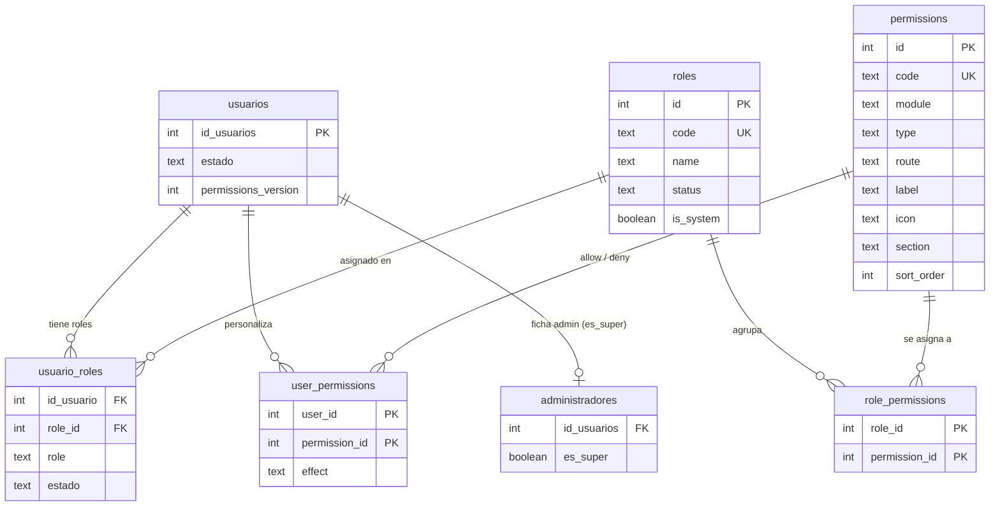
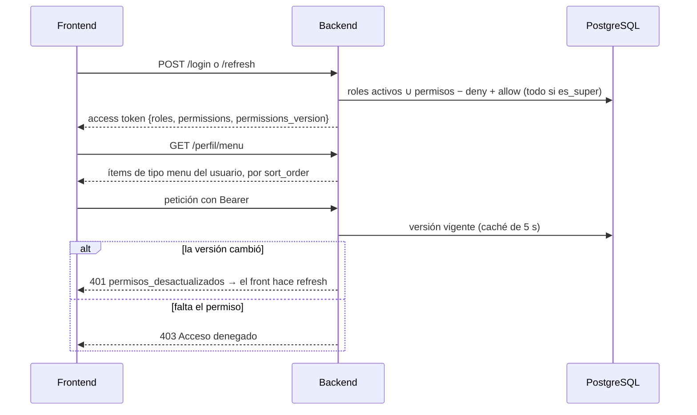

# Roles y permisos

La autorización depende de **permisos**, no del rol. Un usuario puede tener varios roles a la vez. Sus permisos efectivos se calculan en el backend al iniciar sesión y viajan en el access token. No hay que elegir rol: el login combina todos los roles activos.

Hay dos tipos de permiso:

- **`menu`**: un ítem del sidebar. Su permiso también autoriza las consultas (GET) de ese módulo. Ejemplo: `menu.courses.view`.
- **`action`**: una acción concreta, como crear, editar, eliminar o aprobar. Ejemplo: `courses.create`.

## Modelo de datos

| Tabla | Qué guarda |
|---|---|
| `roles` | Catálogo de roles: `id`, `code` (único), `name`, `description`, `status` (`activo` / `inactivo`), `is_system`. Los 4 roles base (`super_administrador`, `administrador`, `profesor`, `estudiante`) son de sistema: no se borran ni se desactivan. |
| `permissions` | Catálogo de permisos: `id`, `code` (único), `module`, `description`, `type` (`menu` / `action`). Los de tipo `menu` llevan además `route`, `label`, `icon`, `section` y `sort_order`, y son los ítems del sidebar. |
| `role_permissions` | Qué permisos tiene cada rol (`role_id`, `permission_id`). |
| `usuario_roles` | Roles de cada usuario: `id_usuario`, `role_id` (FK a `roles`) y `estado` (`Activo` / `Inactivo`). La columna de texto `role` se conserva y un trigger la mantiene sincronizada con `role_id`. |
| `user_permissions` | Personalización por usuario: `user_id`, `permission_id`, `effect` (`allow` / `deny`). |
| `usuarios.permissions_version` | Versión de los accesos del usuario. La incrementan triggers ante cualquier cambio de roles o permisos. |
| `administradores.es_super` | Marca al administrador como super administrador. |



## Permisos efectivos

```
efectivos = (unión de los permisos de todos los roles activos del usuario)
          + permisos con effect = 'allow'
          − permisos con effect = 'deny'
```

Reglas:

1. Solo cuentan las asignaciones `usuario_roles.estado = 'Activo'` de roles con `roles.status = 'activo'`.
2. **Deny gana**: un `deny` quita el permiso aunque un rol lo conceda.
3. **Super administrador** (`administradores.es_super = true`):
   - siempre tiene **todos** los permisos;
   - no se le pueden aplicar personalizaciones;
   - no se le puede quitar el rol `administrador`.
4. La base protege al super administrador con triggers, también ante cambios hechos a mano en pgAdmin:
   - no se puede bloquear (`usuarios.estado`): error `BM001`;
   - siempre debe quedar al menos un super administrador activo: error `BM002`;
   - desde la API, nadie puede quitarse a sí mismo la condición de super.
5. Un usuario activo sin ningún rol activo, y que no sea super, no puede iniciar sesión.

Asignación por defecto (55 permisos: 17 de menú y 38 de acción):

| Rol | Permisos | Incluye |
|---|---|---|
| `administrador` | 31 | Menú de Administración (salvo Accesos, Administradores y Configuración), acciones de estudiantes, profesores, padres, cursos, inscripciones, pagos, recibos y preinscripciones |
| `super_administrador` | todos | Además, por defecto: `menu.access.view`, `menu.admins.view`, `menu.settings.view`, `admins.*`, `settings.enrollment_deadline.update`, `roles.read`, `roles.manage`, `users.access.manage` |
| `profesor` | 10 | Dashboard, Mis cursos, Mis estudiantes, Evaluaciones y sus acciones |
| `estudiante` | 6 | Dashboard, Inscribirme a cursos, Mis cursos y resultados, calificaciones, inscribirse y deudas |

## Tokens y cambios al instante

- **Access token** (10 minutos): `{ id, email, roles, permissions, permissions_version, type: 'access' }`. `roles` incluye `super_administrador` cuando corresponde.
- **Refresh token** (7 días, cookie `httpOnly`): `{ id, email, type: 'refresh' }`. Cada refresh recalcula los permisos desde la base.
- `verificarToken` compara `permissions_version` y el estado del usuario contra la base, con una caché en memoria de 5 segundos que se limpia al guardar desde el panel. Si los accesos cambiaron, responde `401 { error: 'permisos_desactualizados' }`; el frontend renueva el token solo y el sidebar se vuelve a armar.
- `POST /cambiar-rol` se eliminó. El login ignora el campo `role`.



## Backend

- `requirePermission(a, b)` exige todos los permisos indicados; `requireAnyPermission(a, b)` exige al menos uno. Están en `backend/middlewares/requirePermission.js`.
- Todas las rutas de `/admin`, `/docente` y `/estudiante` tienen su permiso. Ninguna mira `req.user.role`.
- `/docente/*` y `/estudiante/*` resuelven la ficha del profesor o del estudiante con `req.user.id`, así que cada uno ve solo sus datos.
- Panel de accesos (`/admin/accesos/...`):

| Método y ruta | Permiso |
|---|---|
| `GET permisos`, `GET roles` | `roles.read` o `users.access.manage` |
| `POST roles`, `PUT roles/:id`, `PUT roles/:id/estado`, `PUT roles/:id/permisos` | `roles.manage` |
| `GET usuarios?buscar=&rol=`, `GET usuarios/:id` | `users.access.manage` |
| `PUT usuarios/:id/roles` `{ roles, fichas? }` | `users.access.manage` |
| `PUT usuarios/:id/permisos` `{ overrides: [{ code, effect }] }`, `DELETE usuarios/:id/permisos` | `users.access.manage` |
| `PUT usuarios/:id/super` `{ esSuper }` | `users.access.manage` |

**Ficha mínima.** Si se asigna `profesor` o `estudiante` a un usuario que no tiene esa ficha, la API responde `422 ficha_requerida` con una sugerencia tomada de otra ficha del mismo usuario. El panel pide estos datos en el mismo modal:

| Campo | Obligatorio | Nota |
|---|---|---|
| `nombre` | sí | |
| `apellidoPaterno` | sí | |
| `ci` | sí | Debe coincidir con el CI de las otras fichas del usuario y no estar repetido en la tabla. |
| `apellidoMaterno`, `telefono` | no | |
| `especialidad` | no | Solo profesor. |
| `colegio` | no | Solo estudiante. |

El email de la ficha se copia del usuario. Quitar un rol deja la asignación en `Inactivo`; no borra datos.

## Frontend

- `views/utils/usuario.js` expone `obtenerRoles()`, `obtenerPermisos()`, `hasPermission(code)` y `hasAnyPermission(...codes)`.
- **Sidebar dinámico**:
  - `AppSidebar` pide `GET /perfil/menu` y agrupa los ítems por `section`, ordenados por `sort_order`;
  - un usuario con varios roles ve un único menú sin duplicados;
  - los íconos se resuelven por nombre en `views/utils/iconosMenu.js`; un nombre desconocido usa un ícono genérico.
- **Rutas**:
  - cada ruta de `routes.js` lleva `permiso: 'menu.….view'`;
  - `ProteccionPermiso` redirige a la primera ruta permitida si falta el permiso;
  - la ruta de inicio después del login también es la primera permitida.
- El panel **Gestión de accesos** tiene tres pestañas: Roles, Usuarios, y Altas y bajas. El botón **Accesos** de las tablas de Administradores, Profesores y Estudiantes abre el mismo modal del usuario.
- Ocultar algo en el frontend es solo usabilidad. La autorización real está en el backend.

## Cómo agregar un ítem al sidebar

1. Crear el permiso de menú en una migración nueva de `db/migrations/` y asignarlo:

   ```sql
   BEGIN;
   INSERT INTO permissions (code, module, description, type, route, label, icon, section, sort_order)
   VALUES ('menu.reports.view', 'reports', 'Ver reportes', 'menu', '/admin/reportes', 'Reportes', 'cilChartPie', 'Administración', 210)
   ON CONFLICT (code) DO NOTHING;
   INSERT INTO role_permissions (role_id, permission_id)
   SELECT r.id, p.id FROM roles r, permissions p
   WHERE r.code = 'administrador' AND p.code = 'menu.reports.view'
   ON CONFLICT DO NOTHING;
   COMMIT;
   ```

2. Proteger las rutas del backend: `router.get('/reportes', requirePermission('menu.reports.view'), getReportes)`.
3. En el frontend:
   - agregar la ruta en `routes.js` con `permiso: 'menu.reports.view'`;
   - si el ícono es nuevo, registrarlo en `iconosMenu.js`.
4. Las acciones del módulo (`reports.export`, …) se crean con `type = 'action'` y el mismo `module`. Así aparecen bajo el ítem en la matriz de permisos.

Los usuarios reciben el ítem al instante: los triggers incrementan `permissions_version` y el siguiente request renueva el token.

## Cómo personalizar un usuario

En **Gestión de accesos → Usuarios** (o con el botón **Accesos** de las tablas):

1. **Roles**: quitar o agregar chips de rol y pulsar *Guardar roles*. Si falta una ficha, completar los datos mínimos.
2. **Permisos**: para cada ítem de menú y cada acción, elegir *Heredado del rol*, *Permitir* o *Denegar*, y pulsar *Guardar permisos*.
3. **Vista previa del menú**: muestra el sidebar que verá el usuario con la configuración actual.
4. **Restablecer a los roles**: borra todas las personalizaciones del usuario.

Ejemplo: para que un estudiante vea solo "Mis cursos y resultados", hay que denegarle `menu.dashboard.view`, `menu.learning.enroll.view`, `learning.enrollments.create` y `learning.debts.read`. Otra forma es crear un rol con solo los permisos deseados y asignárselo en lugar de `estudiante`: un rol nuevo funciona sin cambios de código.
