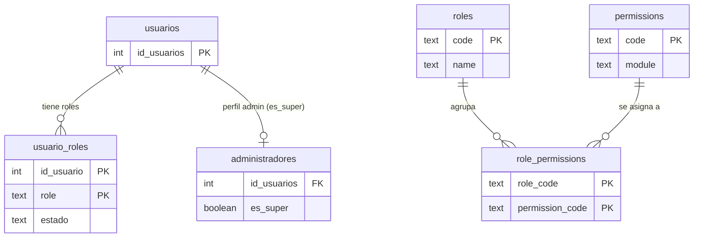
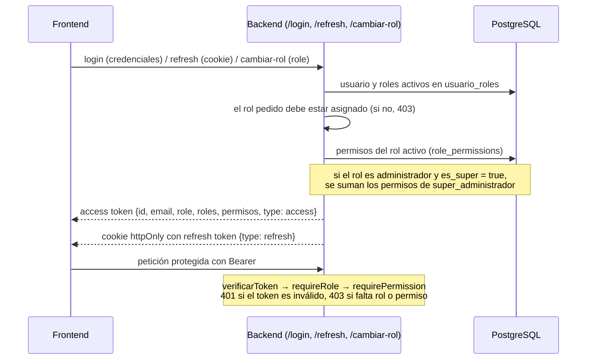

# Roles y permisos

El sistema autoriza en dos niveles:

1. **Rol activo**: `administrador`, `profesor` o `estudiante`. Un usuario puede tener varios roles y elegir cuál usar. El middleware `requireRole` protege grupos completos de rutas.
2. **Permisos del rol activo**: códigos en inglés con puntos (`courses.read`, `settings.enrollment_deadline.update`). Viajan dentro del access token y los verifica `requirePermission`.

## Modelo de datos

| Tabla | Qué guarda |
|---|---|
| `usuario_roles` | Roles asignados a cada usuario (`id_usuario`, `role`, `estado`). Solo cuentan los roles con estado `Activo`. |
| `roles` | Catálogo de roles (`code`, `name`, `description`). Incluye `super_administrador`. |
| `permissions` | Catálogo de permisos (`code`, `module`, `description`). El código debe cumplir el formato `modulo.accion` o `modulo.recurso.accion`, en minúsculas. |
| `role_permissions` | Qué permisos tiene cada rol (`role_code`, `permission_code`). |
| `administradores.es_super` | Marca al administrador como super administrador. |

**Super administrador.** No se asigna en `usuario_roles`. Un usuario con rol activo `administrador` y `administradores.es_super = true` recibe los permisos de `administrador` más los de `super_administrador`.



`usuario_roles.role` no tiene clave foránea a `roles`, para no modificar la tabla existente. La migración `003_permissions.sql` verifica que no haya roles fuera del catálogo.

## Rol × permiso

| Rol | Cantidad | Permisos |
|---|---|---|
| `administrador` | 30 | `students.read/create/update/delete`, `teachers.read/create/update/delete`, `guardians.read/create/update/delete`, `courses.read/create/update/delete`, `courses.enrollment_deadline.update`, `enrollments.read/create/delete`, `payments.read`, `payments.mark_paid`, `receipts.read/create`, `preregistrations.read/approve/reject`, `users.enable`, `admins.super_status.read`, `settings.enrollment_deadline.read` |
| `super_administrador` (por `es_super`) | +6 (36 en total) | `admins.read/create/update/delete/activate`, `settings.enrollment_deadline.update` |
| `profesor` | 9 | `teaching.courses.read`, `teaching.students.read`, `teaching.evaluations.read/create/update/delete`, `teaching.grades.read/create/update` |
| `estudiante` | 5 | `learning.courses.read`, `learning.grades.read`, `learning.available_courses.read`, `learning.enrollments.create`, `learning.debts.read` |

## Tokens y sesión

- **Access token** (10 minutos), enviado como `Authorization: Bearer <token>`: `{ id, email, role, roles, permisos, type: 'access' }`.
- **Refresh token** (7 días), guardado en una cookie `httpOnly`: `{ id, email, role, type: 'refresh' }`.
- `verificarToken` solo acepta el esquema `Bearer` y tokens con `type: 'access'`. Un refresh token no sirve como access token.
- Los permisos se recalculan desde la base en cada login, refresh y cambio de rol.



`GET /perfil` devuelve el usuario de la sesión:

```json
{ "message": "token autorizado", "usuario": { "id": 7, "email": "<email>", "role": "estudiante", "roles": ["estudiante"], "permisos": ["learning.courses.read", "..."] } }
```

## Backend: `requirePermission`

`backend/middlewares/requirePermission.js` recibe uno o más códigos y exige **todos**. Si falta alguno, responde `403 { "message": "Acceso denegado" }`. Va después de `verificarToken`, y convive con `requireRole`, que sigue protegiendo los prefijos en `server.js`.

```js
import { requirePermission } from '../../middlewares/requirePermission.js'

router.put(
  '/cursos/:id/plazo-inscripcion',
  requirePermission('courses.enrollment_deadline.update'),
  validarPlazoCurso,
  validarCampos,
  putPlazoCurso
)
```

## Frontend: `hasPermission`

`frontend/src/views/utils/usuario.js` expone `obtenerPermisos()` y `hasPermission(codigo)`, que leen los permisos del usuario en sesión.

```js
import { hasPermission } from '../../utils/usuario'

const puedeEditarPlazo = hasPermission('courses.enrollment_deadline.update')
{puedeEditarPlazo && <CButton onClick={abrirPlazo}>Plazo</CButton>}
```

Las rutas (`routes.js`) y los ítems del menú (`_nav.js`) aceptan `permiso`, además de `roles`:

```js
{ path: '/admin/configuracion', element: ConfiguracionAcademia, roles: ['administrador'], permiso: 'settings.enrollment_deadline.read' }
```

`ProteccionRol` redirige si falta el rol o el permiso, y `AppSidebarNav` oculta el ítem. Ocultar algo en el frontend es solo usabilidad: la autorización real está en el backend.

## Cómo agregar un permiso nuevo

1. **Crear el permiso y asignarlo** con una migración nueva en `db/migrations/`:

   ```sql
   BEGIN;
   INSERT INTO permissions (code, module, description)
   VALUES ('reports.read', 'reports', 'Ver reportes');
   INSERT INTO role_permissions (role_code, permission_code)
   VALUES ('administrador', 'reports.read');
   COMMIT;
   ```

2. **Proteger la ruta** en el backend:

   ```js
   router.get('/reportes', requirePermission('reports.read'), getReportes)
   ```

3. **Ajustar el frontend**: `permiso: 'reports.read'` en la ruta o el ítem del menú, o `hasPermission('reports.read')` en un botón.
4. **Propagación:** los usuarios reciben el permiso en el próximo login, refresh o cambio de rol. Como el access token dura 10 minutos, el cambio tarda como máximo ese tiempo.

Para un permiso exclusivo del super administrador, se asigna a `super_administrador`.
